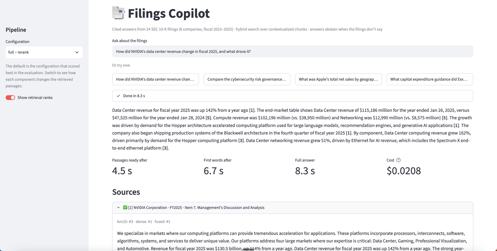
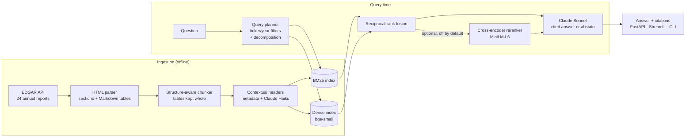
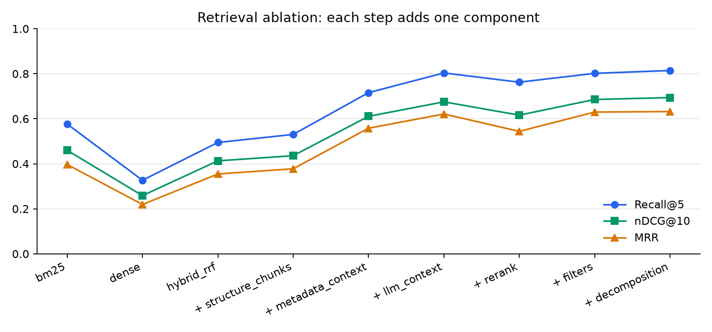

# Filings Copilot

**Cited answers from SEC 10-K filings, and an evaluation harness that measures what each part of the RAG pipeline is worth.**

Ask *"How did NVIDIA's data center revenue change in fiscal 2025, and what drove it?"* and get an answer where every sentence cites the passage it came from, or an explicit "the filings don't say" when they don't.

Most RAG demos stop at "it answers questions." This project is built around the question a client actually asks: *which components earn their latency and cost?* Each technique (hybrid search, structure-aware chunking, contextual chunk headers, reranking, metadata filters, query decomposition) is added one at a time and measured on a span-grounded evaluation set, with confidence intervals on every improvement.

[](https://github.com/KevinBenass/filings-copilot/actions/workflows/ci.yml)

## Example

```bash
uv run fcopilot ask "How did NVIDIA's data center revenue change in fiscal 2025, and what drove it?"
```

> NVIDIA's Data Center revenue for fiscal year 2025 was $115,186 million, compared with $47,525 million in fiscal 2024 and $15,005 million in fiscal 2023 **[6]**. The filing states that Data Center revenue was up 142% from a year ago **[3]**. Computing from the table, ($115,186 − $47,525) / $47,525 is about 142.4%, which matches the stated figure **[6]**. The increase is $67,661 million, calculated as $115,186 million minus $47,525 million **[6]**. Within Data Center, Compute revenue rose to $102,196 million from $38,950 million, and Networking rose to $12,990 million from $8,575 million **[6]**. The filing attributes the growth to demand for the Hopper architecture accelerated computing platform, used for large language models, recommendation engines, and generative AI applications **[3]**. NVIDIA also began shipping production systems of the Blackwell architecture in the fourth quarter of fiscal year 2025 **[3]**. In the segment discussion, Data Center computing revenue grew 162%, driven primarily by Hopper demand, and Data Center networking revenue grew 51%, driven by Ethernet for AI revenue, including the Spectrum-X end-to-end ethernet platform **[1]**. Data Center was also the main driver of the higher gross margin, which rose to 75.0% in fiscal 2025 from 72.7% in fiscal 2024 on a higher mix of Data Center revenue **[2]**.
>
> **[1] [2] [3]** NVIDIA Corporation FY2025, Item 7. Management's Discussion and Analysis
> **[6]** NVIDIA Corporation FY2025, Item 8. Financial Statements and Supplementary Data

Every figure is cited, the stated growth rate is cross-checked against the underlying table, and the explanation comes from management's own discussion. Retrieval filtered to NVIDIA's FY2025 report from the question alone, and the table and the narrative were both found because each chunk carries a header saying whose filing, which year and which section it comes from.

**When the filings don't contain the answer, it says so instead of inventing one.** Apple reports revenue by product and by region, but never iPhone revenue *in* a region:

```bash
uv run fcopilot ask "What was Apple's iPhone revenue in Greater China in fiscal 2025?"
```

> The passages do not give iPhone revenue for Greater China in fiscal 2025. They report Greater China total net sales of $64,377 million for 2025, down 4% from $66,952 million in 2024 **[3][6]**. They say the decrease was primarily due to lower iPhone net sales, partially offset by higher Mac net sales **[1]**. They also say iPhone represented a moderately higher proportion of net sales in Greater China **[2]**. However, no dollar figure or percentage for Greater China iPhone revenue is provided.
>
> *8.1 s · $0.015*

It answers what the filing does disclose and states plainly what it doesn't. This behavior is measured systematically, not just shown once: the evaluation set includes 30 plausible questions the filings cannot answer, and the [results](#results) report how often the system correctly abstains.

### Demo app

`make app` opens a Streamlit UI that shows each step as it runs, streams the answer, and lists the retrieved passages with their rank from each search method (here, BM25 ranked the cited passage 3rd, dense search 1st):



## Architecture



| Stage | Choice | Why |
|---|---|---|
| Parsing | Inline-XBRL HTML → text with Markdown tables; split EDGAR cells (`$` \| `1,234` \| `)`) merged back | Numbers stay intact; the LLM and BM25 both see table structure |
| Sections | `Item N.` headings, table-of-contents entries filtered by span length | Lets chunks, filters and citations name the section (MD&A, Risk Factors…) |
| Chunking | Paragraph packing within an item; tables never split mid-row; captions attached | Fixed windows cut tables in half, the most common failure on financial questions |
| Context | `company · FY · section` header, then a 1–2 sentence situating context written by Claude Haiku | "Revenue increased 12%" is unretrievable without knowing whose revenue and when. Section text is sent as a cached prompt prefix, so each extra chunk costs ~10% of the window |
| Lexical | BM25 | Exact terms matter in finance: "diluted EPS", product names, figures |
| Dense | `BAAI/bge-small-en-v1.5`, exact inner-product search | 12k chunks fit in memory; exact search is a few ms and has perfect recall. Model sized to run on a laptop CPU (see below) |
| Fusion | Reciprocal rank fusion (k=60) | Uses ranks only, so BM25 and cosine scores never need calibrating |
| Filters | Rule-based ticker/year extraction; hard ticker filter, soft year filter (Y and Y+1) | A FY2023 figure is often best found in the FY2024 report's comparison table |
| Rerank | Cross-encoder (`ms-marco-MiniLM-L-6-v2`) over the top 30, **off by default** | Usually a large precision gain, but this CPU-sized model *lowered* Recall@5 and Hit@1 here and added ~1.5 s per query, so the ablation turned it off (see [results](#what-the-ablation-shows)) |
| Generation | Claude Sonnet, JSON output, mandatory `[n]` citations, abstain path | Every claim is traceable; "not in the filings" is a valid answer |

## Corpus

<!-- CORPUS:START -->
24 annual reports from 8 companies, 11.3M characters of text (≈2.8M tokens).

| Company                 | Ticker   | 10-K filings                                                                                                                                                                                                                                                                                     | Fiscal year ends   | Text per filing   | Sections found   |
|:------------------------|:---------|:-------------------------------------------------------------------------------------------------------------------------------------------------------------------------------------------------------------------------------------------------------------------------------------------------|:-------------------|:------------------|:-----------------|
| Apple Inc.              | AAPL     | [FY2023](https://www.sec.gov/Archives/edgar/data/320193/000032019323000106/aapl-20230930.htm) · [FY2024](https://www.sec.gov/Archives/edgar/data/320193/000032019324000123/aapl-20240928.htm) · [FY2025](https://www.sec.gov/Archives/edgar/data/320193/000032019325000079/aapl-20250927.htm)    | 09-27              | 212k chars        | 13–14            |
| Amazon.com, Inc.        | AMZN     | [FY2023](https://www.sec.gov/Archives/edgar/data/1018724/000101872424000008/amzn-20231231.htm) · [FY2024](https://www.sec.gov/Archives/edgar/data/1018724/000101872425000004/amzn-20241231.htm) · [FY2025](https://www.sec.gov/Archives/edgar/data/1018724/000101872426000004/amzn-20251231.htm) | 12-31              | 291k chars        | 13–13            |
| Alphabet Inc.           | GOOGL    | [FY2023](https://www.sec.gov/Archives/edgar/data/1652044/000165204424000022/goog-20231231.htm) · [FY2024](https://www.sec.gov/Archives/edgar/data/1652044/000165204425000014/goog-20241231.htm) · [FY2025](https://www.sec.gov/Archives/edgar/data/1652044/000165204426000018/goog-20251231.htm) | 12-31              | 360k chars        | 13–13            |
| Johnson & Johnson       | JNJ      | [FY2023](https://www.sec.gov/Archives/edgar/data/200406/000020040624000013/jnj-20231231.htm) · [FY2024](https://www.sec.gov/Archives/edgar/data/200406/000020040625000038/jnj-20241229.htm) · [FY2025](https://www.sec.gov/Archives/edgar/data/200406/000020040626000016/jnj-20251228.htm)       | 12-28              | 441k chars        | 15–15            |
| JPMorgan Chase & Co.    | JPM      | [FY2023](https://www.sec.gov/Archives/edgar/data/19617/000001961724000225/jpm-20231231.htm) · [FY2024](https://www.sec.gov/Archives/edgar/data/19617/000001961725000270/jpm-20241231.htm) · [FY2025](https://www.sec.gov/Archives/edgar/data/19617/000162828026008131/jpm-20251231.htm)          | 12-31              | 1,289k chars      | 12–12            |
| Microsoft Corporation   | MSFT     | [FY2023](https://www.sec.gov/Archives/edgar/data/789019/000095017023035122/msft-20230630.htm) · [FY2024](https://www.sec.gov/Archives/edgar/data/789019/000095017024087843/msft-20240630.htm) · [FY2025](https://www.sec.gov/Archives/edgar/data/789019/000095017025100235/msft-20250630.htm)    | 06-30              | 359k chars        | 12–13            |
| NVIDIA Corporation      | NVDA     | [FY2023](https://www.sec.gov/Archives/edgar/data/1045810/000104581023000017/nvda-20230129.htm) · [FY2024](https://www.sec.gov/Archives/edgar/data/1045810/000104581024000029/nvda-20240128.htm) · [FY2025](https://www.sec.gov/Archives/edgar/data/1045810/000104581025000023/nvda-20250126.htm) | 01-26              | 345k chars        | 14–16            |
| Exxon Mobil Corporation | XOM      | [FY2023](https://www.sec.gov/Archives/edgar/data/34088/000003408824000018/xom-20231231.htm) · [FY2024](https://www.sec.gov/Archives/edgar/data/34088/000003408825000010/xom-20241231.htm) · [FY2025](https://www.sec.gov/Archives/edgar/data/34088/000003408826000045/xom-20251231.htm)          | 12-31              | 474k chars        | 13–14            |
<!-- CORPUS:END -->

## Evaluation

The eval set is the core of the project. Design choices that matter:

- **Span-grounded labels.** Each question carries a verbatim quote that is located in the filing as a character span. A retrieved chunk is relevant if it overlaps the span. Labels therefore survive re-chunking, which is what makes the chunking comparison fair. Questions whose quote can't be found verbatim are discarded.
- **Four question types**, reported separately because averages hide failure modes: single-hop prose, table lookups, multi-hop comparisons (two companies or two years), and unanswerable questions that test abstention.
- **Leakage check.** Synthetic questions that copy the passage's wording inflate BM25. Generation prompts require paraphrase, and the mean lexical overlap between question and evidence is reported.
- **Human review.** `fcopilot review` walks through every item to accept, edit or drop it; the README states how many were verified.
- **Metrics.** Retrieval: Recall@k, MRR, nDCG@10, Hit@1, with multi-evidence gain (retrieving the same fact twice earns nothing). Generation: correctness against the reference, faithfulness (share of atomic claims supported by the passages), citation precision, false-abstention rate and correct-abstention rate, judged by a different model tier than the generator.
- **Statistics.** Every ablation step reports a paired bootstrap 95% CI on the change in Recall@5, so a +0.01 is not mistaken for progress.

## Results

<!-- RESULTS:START -->
### Evaluation set
310 questions: 180 single-hop, 60 table, 40 multi-hop, 30 unanswerable. Each answerable question is tied to a verbatim evidence span in a filing.
A stratified random sample of 50 questions was reviewed by hand: 50 accepted as generated, 0 corrected, 0 removed (100% usable without changes).
Lexical leakage: on average 46% of an evidence quote's content words also appear in its question. Some overlap is inherent (a question about "data center revenue" must say so), but it favors keyword search, so BM25's scores here are likely optimistic.

### Retrieval ablation
Evaluated on 280 answerable questions. Δ CI is a paired bootstrap 95% interval for the change in Recall@5 versus the row above.



| config             | recall@5   | recall@10   | mrr   | ndcg@10   | hit@1   | Δrecall@5 95% CI   | p50_ms   |
|:-------------------|:-----------|:------------|:------|:----------|:--------|:-------------------|:---------|
| bm25               | 0.577      | 0.688       | 0.397 | 0.460     | 0.243   |                    | 40       |
| dense              | 0.327      | 0.416       | 0.219 | 0.259     | 0.114   | [-0.321, -0.180]   | 24       |
| hybrid_rrf         | 0.495      | 0.636       | 0.355 | 0.413     | 0.225   | [+0.118, +0.218]   | 70       |
| + structure_chunks | 0.530      | 0.655       | 0.378 | 0.436     | 0.243   | [-0.025, +0.098]   | 102      |
| + metadata_context | 0.716      | 0.818       | 0.558 | 0.611     | 0.418   | [+0.132, +0.239]   | 105      |
| + llm_context      | 0.804      | 0.884       | 0.621 | 0.675     | 0.464   | [+0.045, +0.132]   | 103      |
| + rerank           | 0.762      | 0.893       | 0.544 | 0.616     | 0.361   | [-0.087, +0.004]   | 3033     |
| + filters          | 0.802      | 0.912       | 0.630 | 0.686     | 0.457   | [+0.014, +0.068]   | 2969     |
| + decomposition    | 0.814      | 0.930       | 0.632 | 0.694     | 0.464   | [-0.004, +0.029]   | 4955     |
| full − rerank      | 0.818      | 0.887       | 0.675 | 0.717     | 0.554   | [-0.039, +0.046]   | 1759     |

Recall@5 by question type:

| config             | recall@5[multi_hop]   | recall@5[single_hop]   | recall@5[table]   |
|:-------------------|:----------------------|:-----------------------|:------------------|
| bm25               | 0.338                 | 0.678                  | 0.433             |
| dense              | 0.312                 | 0.389                  | 0.150             |
| hybrid_rrf         | 0.388                 | 0.567                  | 0.350             |
| + structure_chunks | 0.362                 | 0.622                  | 0.367             |
| + metadata_context | 0.562                 | 0.739                  | 0.750             |
| + llm_context      | 0.550                 | 0.856                  | 0.817             |
| + rerank           | 0.512                 | 0.817                  | 0.767             |
| + filters          | 0.562                 | 0.861                  | 0.783             |
| + decomposition    | 0.675                 | 0.856                  | 0.783             |
| full − rerank      | 0.625                 | 0.856                  | 0.833             |

### End-to-end answer quality
Retrieval configuration `full − rerank` (the best Recall@5 in the ablation), answer model `claude-sonnet-5-5`, judge `claude-haiku-5-5`, 310 questions, total eval cost $6.81. Correctness, faithfulness and citation precision are averaged over graded answers; abstentions on answerable questions count as incorrect.

| question type                     | n   | graded   | correctness   | faithfulness   | citation precision   | false abstention   |
|:----------------------------------|:----|:---------|:--------------|:---------------|:---------------------|:-------------------|
| multi_hop                         | 40  | 40       | 0.637         | 1.000          | 1.000                | 0.300              |
| single_hop                        | 180 | 180      | 0.925         | 0.982          | 0.995                | 0.044              |
| table                             | 60  | 60       | 0.925         | 0.990          | 0.997                | 0.017              |
| **all answerable**                | 280 | 280      | 0.884         | 0.986          | 0.996                | 0.075              |
| unanswerable (correct abstention) | 30  | 30       | 1.000         |                |                      |                    |
<!-- RESULTS:END -->

### What the ablation shows

- **Context beats architecture.** The largest gains come from telling each chunk where it sits: a `company · FY · section` header (+0.19 Recall@5) and an LLM-written situating sentence (+0.09). Switching from BM25 to hybrid search alone made things *worse*, likely because the small dense model can't tell one company's "revenue increased" from another's.
- **The reranker was turned off because the measurement said so.** A small cross-encoder sized for a laptop CPU lowered Recall@5 (0.804 → 0.762) and Hit@1, and cost 3 s per query. The final row removes it from the full pipeline: Recall@5 0.818, Hit@1 0.554 (best of all rows), at 1.8 s instead of 5.0 s. The shipped configuration is picked automatically from this table (`best_config()`), so the API and app always use the measured winner. A larger reranker on a GPU might change the verdict, and testing that is a one-line config change.
- **Decomposition is what fixes multi-hop retrieval.** Splitting "compare A and B" into one search per company raises multi-hop Recall@5 from 0.56 to 0.68; it does nothing for single-passage questions, as expected.
- **The generator is faithful and cautious.** 98.6% of claims are supported by the retrieved passages and 99.6% of citations support what they're cited for. All 30 unanswerable questions were correctly declined. On multi-hop questions it declines 30% of the time, typically when one of the two companies' figures is missing from the passages; when it does answer, it is right about 91% of the time (0.64 correctness ÷ 0.70 answered).

### How the evaluation was debugged

The first full run reported multi-hop correctness of 0.30. Before trusting it, I checked how many answers had actually been graded: over a quarter of the judge's replies had been cut off at the token limit and silently dropped, mostly long multi-hop answers. The fix was schema-constrained structured outputs for both the answer and the judge, retries with more room, and a `graded` column so a dropped grade can never hide in an average again. Every row above now shows graded = n.

## Quickstart

Requires Python 3.11+, [uv](https://docs.astral.sh/uv/), and an Anthropic API key for the generative steps.

```bash
make setup             # install, create .env (add ANTHROPIC_API_KEY and SEC_USER_AGENT)
make data              # download + parse 24 10-Ks from EDGAR            free, ~2 min
make index             # chunk, contextualize, embed                     ~$10-20, ~15 min CPU
make evalset           # generate the gold set, then `uv run fcopilot review`   ~$2
make eval              # retrieval ablation + end-to-end eval + report   ~$10
make app               # Streamlit demo at localhost:8501 (answers stream in: first words after ~2 s)
```

Retrieval runs without an API key:

```bash
uv run fcopilot ask "What were Apple's net sales by geographic segment in fiscal 2024?" --no-generate
```

All LLM calls go through a SQLite cache, so re-running an eval is free and reproducible. Costs are tracked per call and reported with the results.

### API

```bash
make api
curl -s localhost:8000/ask -H 'content-type: application/json' \
  -d '{"question": "Compare the cybersecurity governance of JPMorgan and Microsoft in fiscal 2024"}' | jq .answer
```

`POST /retrieve` returns ranked passages only; the [equity-research-agents](https://github.com/KevinBenass/equity-research-agents) project uses it as a tool.

## Repository layout

```
src/filings_copilot/
  ingest/      edgar.py · parse.py · chunking.py · contextualize.py · store.py
  index/       bm25.py · dense.py
  retrieve/    query.py · fusion.py · rerank.py · pipeline.py · factory.py
  generate/    answer.py
  eval/        dataset.py · retrieval_metrics.py · generation_metrics.py · runner.py · report.py
  llm.py       Claude client: disk cache, prompt caching, cost accounting
  api.py       FastAPI service
  cli.py       `fcopilot` command line
configs/       default.yaml (every parameter) · ablations.yaml (the ablation ladder)
app/           Streamlit demo
tests/         unit tests with a synthetic 10-K and stand-in models (no network, no GPU)
```

## Limitations and next steps

- **LLM-as-judge.** Generation metrics come from an LLM grader. It runs on a different model tier than the generator, and a sample is checked by hand, but it is not a substitute for expert labels.
- **Multi-hop answers abstain too often** (30%). Retrieval returns 5–8 passages; a comparison needs both companies' figures in them. Next steps: retrieve a fixed quota per sub-question, or let the generator ask for a second search.
- **Lexical leakage.** Questions share 46% of their content words with their evidence, which flatters BM25. The relative ordering of the later steps is what matters; absolute BM25 scores are likely optimistic.
- **Synthetic questions** skew toward what is easy to ask about a single passage. Multi-hop and unanswerable questions are included to counter this, and the review step removes unnatural ones.
- **Model sizes are chosen for a laptop CPU.** The full pipeline, including four embedding variants for the ablation and a reranker in the ablation, runs on an Intel MacBook with no GPU. A larger embedder (`bge-large-en-v1.5`) and reranker (`bge-reranker-v2-m3`) are one config change away on a GPU and would likely lift absolute scores; the ablation measures relative gains, which this setup captures.
- **Corpus size.** 24 filings is enough to separate the techniques, not to claim production scale. The exact dense index would be swapped for an ANN index (HNSW) beyond a few hundred thousand chunks.
- **Numbers from tables** are read by the LLM, not computed. A natural extension is routing quantitative questions to the structured XBRL data, which the multi-agent project does.

## How this was built

Designed and evaluated by me; implemented with Claude Code. Every result in this README was produced on my machine, and I reviewed the outputs and made the evaluation and design decisions.

## License

MIT. SEC filings are public domain.
