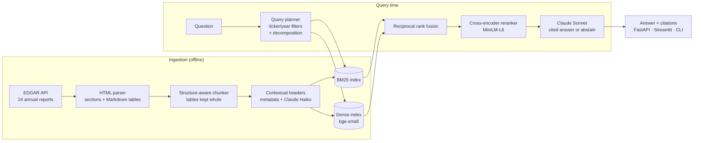

# Filings Copilot

**Cited answers from SEC 10-K filings, and an evaluation harness that measures what each part of the RAG pipeline is worth.**

Ask *"How did NVIDIA's data center revenue change in fiscal 2025, and what drove it?"* and get an answer where every sentence cites the passage it came from, or an explicit "the filings don't say" when they don't.

Most RAG demos stop at "it answers questions." This project is built around the question a client actually asks: *which components earn their latency and cost?* Each technique (hybrid search, structure-aware chunking, contextual chunk headers, reranking, metadata filters, query decomposition) is added one at a time and measured on a span-grounded evaluation set, with confidence intervals on every improvement.

[](https://github.com/KevinBenass/filings-copilot/actions/workflows/ci.yml)

## Architecture



| Stage | Choice | Why |
|---|---|---|
| Parsing | Inline-XBRL HTML → text with Markdown tables; split EDGAR cells (`$` \| `1,234` \| `)`) merged back | Numbers stay intact; the LLM and BM25 both see table structure |
| Sections | `Item N.` headings, table-of-contents entries filtered by span length | Lets chunks, filters and citations name the section (MD&A, Risk Factors…) |
| Chunking | Paragraph packing within an item; tables never split mid-row; captions attached | Fixed windows cut tables in half, the most common failure on financial questions |
| Context | `company · FY · section` header, then a 1–2 sentence situating context written by Claude Haiku | "Revenue increased 12%" is unretrievable without knowing whose revenue and when. Section text is sent as a cached prompt prefix, so each extra chunk costs ~10% of the window |
| Lexical | BM25 | Exact terms matter in finance: "diluted EPS", product names, figures |
| Dense | `BAAI/bge-small-en-v1.5`, exact inner-product search | 12k chunks fit in memory; exact search is a few ms and has perfect recall. Model sized to run on a laptop CPU (see below) |
| Fusion | Reciprocal rank fusion (k=60) | Uses ranks only, so BM25 and cosine scores never need calibrating |
| Filters | Rule-based ticker/year extraction; hard ticker filter, soft year filter (Y and Y+1) | A FY2023 figure is often best found in the FY2024 report's comparison table |
| Rerank | Cross-encoder (`ms-marco-MiniLM-L-6-v2`) over the top 30 | Reads query and passage jointly; usually the biggest single precision gain in a RAG system |
| Generation | Claude Sonnet, JSON output, mandatory `[n]` citations, abstain path | Every claim is traceable; "not in the filings" is a valid answer |

## Corpus

<!-- CORPUS:START -->
24 annual reports from 8 companies, 11.3M characters of text (≈2.8M tokens).

| Company                 | Ticker   | 10-K filings                                                                                                                                                                                                                                                                                     | Fiscal year ends   | Text per filing   | Sections found   |
|:------------------------|:---------|:-------------------------------------------------------------------------------------------------------------------------------------------------------------------------------------------------------------------------------------------------------------------------------------------------|:-------------------|:------------------|:-----------------|
| Apple Inc.              | AAPL     | [FY2023](https://www.sec.gov/Archives/edgar/data/320193/000032019323000106/aapl-20230930.htm) · [FY2024](https://www.sec.gov/Archives/edgar/data/320193/000032019324000123/aapl-20240928.htm) · [FY2025](https://www.sec.gov/Archives/edgar/data/320193/000032019325000079/aapl-20250927.htm)    | 09-27              | 212k chars        | 13–14            |
| Amazon.com, Inc.        | AMZN     | [FY2023](https://www.sec.gov/Archives/edgar/data/1018724/000101872424000008/amzn-20231231.htm) · [FY2024](https://www.sec.gov/Archives/edgar/data/1018724/000101872425000004/amzn-20241231.htm) · [FY2025](https://www.sec.gov/Archives/edgar/data/1018724/000101872426000004/amzn-20251231.htm) | 12-31              | 291k chars        | 13–13            |
| Alphabet Inc.           | GOOGL    | [FY2023](https://www.sec.gov/Archives/edgar/data/1652044/000165204424000022/goog-20231231.htm) · [FY2024](https://www.sec.gov/Archives/edgar/data/1652044/000165204425000014/goog-20241231.htm) · [FY2025](https://www.sec.gov/Archives/edgar/data/1652044/000165204426000018/goog-20251231.htm) | 12-31              | 360k chars        | 13–13            |
| Johnson & Johnson       | JNJ      | [FY2023](https://www.sec.gov/Archives/edgar/data/200406/000020040624000013/jnj-20231231.htm) · [FY2024](https://www.sec.gov/Archives/edgar/data/200406/000020040625000038/jnj-20241229.htm) · [FY2025](https://www.sec.gov/Archives/edgar/data/200406/000020040626000016/jnj-20251228.htm)       | 12-28              | 441k chars        | 15–15            |
| JPMorgan Chase & Co.    | JPM      | [FY2023](https://www.sec.gov/Archives/edgar/data/19617/000001961724000225/jpm-20231231.htm) · [FY2024](https://www.sec.gov/Archives/edgar/data/19617/000001961725000270/jpm-20241231.htm) · [FY2025](https://www.sec.gov/Archives/edgar/data/19617/000162828026008131/jpm-20251231.htm)          | 12-31              | 1,289k chars      | 12–12            |
| Microsoft Corporation   | MSFT     | [FY2023](https://www.sec.gov/Archives/edgar/data/789019/000095017023035122/msft-20230630.htm) · [FY2024](https://www.sec.gov/Archives/edgar/data/789019/000095017024087843/msft-20240630.htm) · [FY2025](https://www.sec.gov/Archives/edgar/data/789019/000095017025100235/msft-20250630.htm)    | 06-30              | 359k chars        | 12–13            |
| NVIDIA Corporation      | NVDA     | [FY2023](https://www.sec.gov/Archives/edgar/data/1045810/000104581023000017/nvda-20230129.htm) · [FY2024](https://www.sec.gov/Archives/edgar/data/1045810/000104581024000029/nvda-20240128.htm) · [FY2025](https://www.sec.gov/Archives/edgar/data/1045810/000104581025000023/nvda-20250126.htm) | 01-26              | 345k chars        | 14–16            |
| Exxon Mobil Corporation | XOM      | [FY2023](https://www.sec.gov/Archives/edgar/data/34088/000003408824000018/xom-20231231.htm) · [FY2024](https://www.sec.gov/Archives/edgar/data/34088/000003408825000010/xom-20241231.htm) · [FY2025](https://www.sec.gov/Archives/edgar/data/34088/000003408826000045/xom-20251231.htm)          | 12-31              | 474k chars        | 13–14            |
<!-- CORPUS:END -->

## Evaluation

The eval set is the core of the project. Design choices that matter:

- **Span-grounded labels.** Each question carries a verbatim quote that is located in the filing as a character span. A retrieved chunk is relevant if it overlaps the span. Labels therefore survive re-chunking, which is what makes the chunking comparison fair. Questions whose quote can't be found verbatim are discarded.
- **Four question types**, reported separately because averages hide failure modes: single-hop prose, table lookups, multi-hop comparisons (two companies or two years), and unanswerable questions that test abstention.
- **Leakage check.** Synthetic questions that copy the passage's wording inflate BM25. Generation prompts require paraphrase, and the mean lexical overlap between question and evidence is reported.
- **Human review.** `fcopilot review` walks through every item to accept, edit or drop it; the README states how many were verified.
- **Metrics.** Retrieval: Recall@k, MRR, nDCG@10, Hit@1, with multi-evidence gain (retrieving the same fact twice earns nothing). Generation: correctness against the reference, faithfulness (share of atomic claims supported by the passages), citation precision, false-abstention rate and correct-abstention rate, judged by a different model tier than the generator.
- **Statistics.** Every ablation step reports a paired bootstrap 95% CI on the change in Recall@5, so a +0.01 is not mistaken for progress.

## Results

<!-- RESULTS:START -->
_Results are generated by `make eval` and written here by `make report`._
<!-- RESULTS:END -->

## Quickstart

Requires Python 3.11+, [uv](https://docs.astral.sh/uv/), and an Anthropic API key for the generative steps.

```bash
make setup             # install, create .env (add ANTHROPIC_API_KEY and SEC_USER_AGENT)
make data              # download + parse 24 10-Ks from EDGAR            free, ~2 min
make index             # chunk, contextualize, embed                     ~$10-20, ~15 min CPU
make evalset           # generate the gold set, then `uv run fcopilot review`   ~$2
make eval              # retrieval ablation + end-to-end eval + report   ~$10
make app               # Streamlit demo at localhost:8501
```

Retrieval runs without an API key:

```bash
uv run fcopilot ask "What were Apple's net sales by geographic segment in fiscal 2024?" --no-generate
```

All LLM calls go through a SQLite cache, so re-running an eval is free and reproducible. Costs are tracked per call and reported with the results.

### API

```bash
make api
curl -s localhost:8000/ask -H 'content-type: application/json' \
  -d '{"question": "Compare the cybersecurity governance of JPMorgan and Microsoft in fiscal 2024"}' | jq .answer
```

`POST /retrieve` returns ranked passages only; the [equity-research-agents](https://github.com/KevinBenass/equity-research-agents) project uses it as a tool.

## Repository layout

```
src/filings_copilot/
  ingest/      edgar.py · parse.py · chunking.py · contextualize.py · store.py
  index/       bm25.py · dense.py
  retrieve/    query.py · fusion.py · rerank.py · pipeline.py · factory.py
  generate/    answer.py
  eval/        dataset.py · retrieval_metrics.py · generation_metrics.py · runner.py · report.py
  llm.py       Claude client: disk cache, prompt caching, cost accounting
  api.py       FastAPI service
  cli.py       `fcopilot` command line
configs/       default.yaml (every parameter) · ablations.yaml (the ablation ladder)
app/           Streamlit demo
tests/         unit tests with a synthetic 10-K and stand-in models (no network, no GPU)
```

## Limitations and next steps

- **LLM-as-judge.** Generation metrics come from an LLM grader. It runs on a different model tier than the generator, and a sample is checked by hand, but it is not a substitute for expert labels.
- **Synthetic questions** skew toward what is easy to ask about a single passage. Multi-hop and unanswerable questions are included to counter this, and the review step removes unnatural ones.
- **Model sizes are chosen for a laptop CPU.** The full pipeline, including four embedding variants for the ablation and reranking every evaluation query, runs on an Intel MacBook with no GPU. A larger embedder (`bge-large-en-v1.5`) and reranker (`bge-reranker-v2-m3`) are one config change away on a GPU and would likely lift absolute scores; the ablation measures relative gains, which this setup captures.
- **Corpus size.** 24 filings is enough to separate the techniques, not to claim production scale. The exact dense index would be swapped for an ANN index (HNSW) beyond a few hundred thousand chunks.
- **Numbers from tables** are read by the LLM, not computed. A natural extension is routing quantitative questions to the structured XBRL data, which the multi-agent project does.

## License

MIT. SEC filings are public domain.
