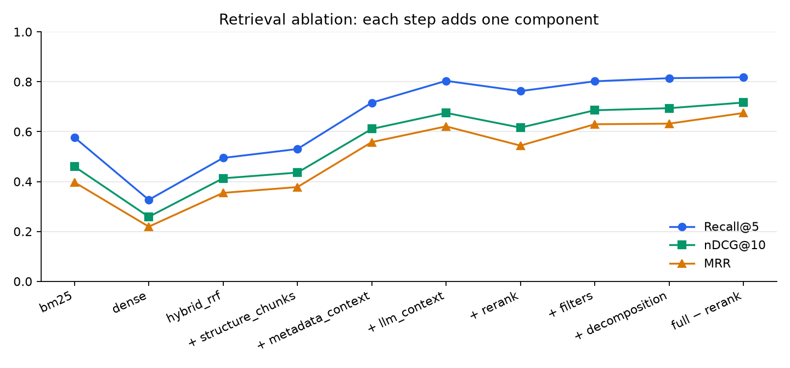

# Results

### Evaluation set
310 questions: 180 single-hop, 60 table, 40 multi-hop, 30 unanswerable. Each answerable question is tied to a verbatim evidence span in a filing.
A stratified random sample of 50 questions was reviewed by hand: 50 accepted as generated, 0 corrected, 0 removed (100% usable without changes).
Lexical leakage: on average 46% of an evidence quote's content words also appear in its question. Some overlap is inherent (a question about "data center revenue" must say so), but it favors keyword search, so BM25's scores here are likely optimistic.

### Retrieval ablation
Evaluated on 280 answerable questions. Δ CI is a paired bootstrap 95% interval for the change in Recall@5 versus the row above.

| config             | recall@5   | recall@10   | mrr   | ndcg@10   | hit@1   | Δrecall@5 95% CI   | p50_ms   |
|:-------------------|:-----------|:------------|:------|:----------|:--------|:-------------------|:---------|
| bm25               | 0.577      | 0.688       | 0.397 | 0.460     | 0.243   |                    | 40       |
| dense              | 0.327      | 0.416       | 0.219 | 0.259     | 0.114   | [-0.321, -0.180]   | 24       |
| hybrid_rrf         | 0.495      | 0.636       | 0.355 | 0.413     | 0.225   | [+0.118, +0.218]   | 70       |
| + structure_chunks | 0.530      | 0.655       | 0.378 | 0.436     | 0.243   | [-0.025, +0.098]   | 102      |
| + metadata_context | 0.716      | 0.818       | 0.558 | 0.611     | 0.418   | [+0.132, +0.239]   | 105      |
| + llm_context      | 0.804      | 0.884       | 0.621 | 0.675     | 0.464   | [+0.045, +0.132]   | 103      |
| + rerank           | 0.762      | 0.893       | 0.544 | 0.616     | 0.361   | [-0.087, +0.004]   | 3033     |
| + filters          | 0.802      | 0.912       | 0.630 | 0.686     | 0.457   | [+0.014, +0.068]   | 2969     |
| + decomposition    | 0.814      | 0.930       | 0.632 | 0.694     | 0.464   | [-0.004, +0.029]   | 4955     |
| full − rerank      | 0.818      | 0.887       | 0.675 | 0.717     | 0.554   | [-0.039, +0.046]   | 1759     |

Recall@5 by question type:

| config             | recall@5[multi_hop]   | recall@5[single_hop]   | recall@5[table]   |
|:-------------------|:----------------------|:-----------------------|:------------------|
| bm25               | 0.338                 | 0.678                  | 0.433             |
| dense              | 0.312                 | 0.389                  | 0.150             |
| hybrid_rrf         | 0.388                 | 0.567                  | 0.350             |
| + structure_chunks | 0.362                 | 0.622                  | 0.367             |
| + metadata_context | 0.562                 | 0.739                  | 0.750             |
| + llm_context      | 0.550                 | 0.856                  | 0.817             |
| + rerank           | 0.512                 | 0.817                  | 0.767             |
| + filters          | 0.562                 | 0.861                  | 0.783             |
| + decomposition    | 0.675                 | 0.856                  | 0.783             |
| full − rerank      | 0.625                 | 0.856                  | 0.833             |

### End-to-end answer quality
Retrieval configuration `full − rerank` (the best Recall@5 in the ablation), answer model `claude-sonnet-5-5`, judge `claude-haiku-5-5`, 310 questions, total eval cost $6.81. Correctness, faithfulness and citation precision are averaged over graded answers; abstentions on answerable questions count as incorrect.

| question type                     | n   | graded   | correctness   | faithfulness   | citation precision   | false abstention   |
|:----------------------------------|:----|:---------|:--------------|:---------------|:---------------------|:-------------------|
| multi_hop                         | 40  | 40       | 0.637         | 1.000          | 1.000                | 0.300              |
| single_hop                        | 180 | 180      | 0.925         | 0.982          | 0.995                | 0.044              |
| table                             | 60  | 60       | 0.925         | 0.990          | 0.997                | 0.017              |
| **all answerable**                | 280 | 280      | 0.884         | 0.986          | 0.996                | 0.075              |
| unanswerable (correct abstention) | 30  | 30       | 1.000         |                |                      |                    |
